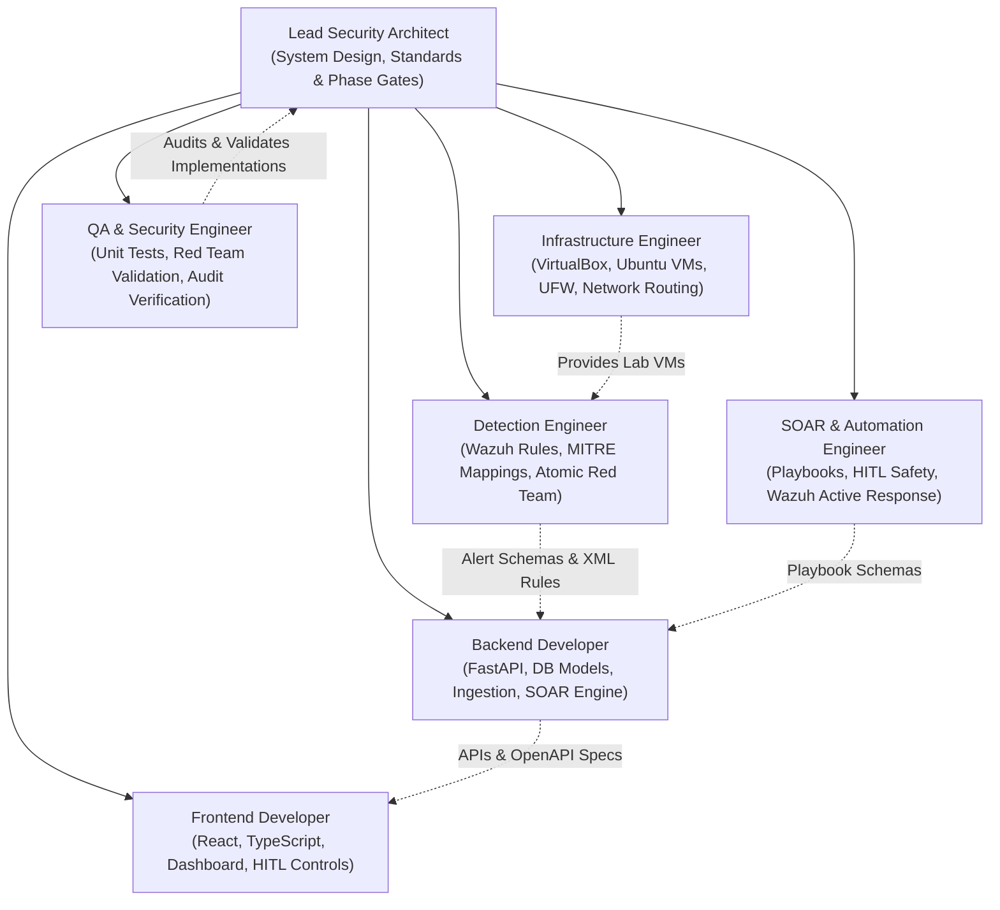

# SentinelOps — Multi-Agent Development Workflow & Team Governance

## 1. Multi-Agent Development Philosophy
SentinelOps adheres to an institutional-grade, multi-agent development workflow. Each agent persona maintains distinct role boundaries, inputs, deliverables, and safety gates to ensure architectural integrity on our Windows 11 / VirtualBox platform.

---

## 2. Agent Roster & Operational Boundaries

### Agent Roles & Explicit Boundaries

| Agent Persona | Core Responsibilities | Explicit Out-of-Bounds Boundaries | Key Upstream Dependencies |
| :--- | :--- | :--- | :--- |
| **Lead Security Architect** | System specifications, cross-domain integrity, phase transitions, and risk management. | Does not write application code directly unless prototyping architectural spikes. | User requirements & PRD |
| **Infrastructure Engineer** | VirtualBox VM creation, Ubuntu provisioning, static IP routing, UFW firewall rules, emergency scripts. | Does not write backend business logic or frontend components. | Lead Architect specifications |
| **Detection Engineer** | Custom Wazuh detection XML rules, Auditd configuration on VM 2, MITRE ATT&CK mapping, Atomic Red Team test suites. | Does not modify backend API routes or React UI code. | Infrastructure setup (Wazuh running) |
| **Backend Developer** | FastAPI endpoints, SQLAlchemy 2.0 models, PostgreSQL deduplication queries, alert ingestion, and RBAC. | Does not write raw Wazuh XML decoders or React UI components. | Detection alert schemas & DB design |
| **Frontend Developer** | React/TypeScript UI (Incident Triage, Alert Feed, Playbook HITL Approval, MITRE Matrix), WebSocket hooks. | Does not write database queries or bypass API contracts. | Backend API endpoints (OpenAPI spec) |
| **SOAR Engineer** | Playbook parameter schemas, Wazuh Active Response integration, human approval checks, and zero-shell validation. | Never allows arbitrary shell string execution; restricted strictly to allowlisted parameter models. | Backend core & Wazuh Manager API |
| **QA & Security Engineer** | Pytest unit/integration test suites, injection defense audits, tamper detection verification, and end-to-end runs. | Cannot waive security requirements or approve untested playbooks. | All functional implementations |

---

## 3. Inter-Agent Handoff & Governance Protocol

1. **Architecture Before Code**: No code can be written without a referenced section in the approved architecture docs.
2. **Strict Phase Gate Transitions**: A phase cannot be marked complete until all acceptance criteria in the Master Roadmap are verified.
3. **Detection Validation Contract**: The Detection Engineer must provide an Atomic Red Team simulation script for every custom rule created.
4. **Safety & Zero-Shell Verification**: Any PR or code introducing active response logic must be formally verified by the QA & Security Engineer for zero arbitrary command injection vulnerabilities.
