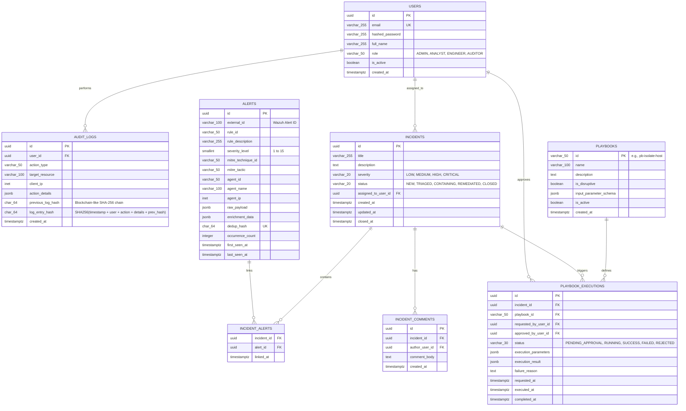

# SentinelOps — Database Schema & Architecture Design

## 1. Storage Engine & Design Principles
- **Engine**: PostgreSQL 16 (running on VM 1: SOC Server).
- **ORM / Migrations**: SQLAlchemy 2.0 (Async) + Alembic.
- **Key Design Decisions**:
  - Relational consistency with explicit foreign keys.
  - Initial deduplication handled directly in PostgreSQL using a composite `dedup_hash` unique constraint and index, eliminating the memory overhead of Redis on our 8 GB VM.
  - JSONB columns for dynamic telemetry and enrichment payloads with GIN indexing.
  - Strict distinction between **application-level cryptographic integrity** (SHA-256 chaining) and **database-level append-only permissions** (revoking `UPDATE` and `DELETE` on audit tables).

---

## 2. Entity-Relationship Diagram (ERD)



---

## 3. Database Permissions & Append-Only Audit Security

To satisfy the strict security requirement distinguishing database access controls from cryptographic integrity:

### 3.1 PostgreSQL Role Privileges (Least Privilege)
```sql
-- Create application user role
CREATE ROLE sentinelops_app WITH LOGIN PASSWORD 'SecureAppRolePassword';

-- Grant standard CRUD on operational tables
GRANT SELECT, INSERT, UPDATE, DELETE ON users, incidents, incident_comments, playbook_executions TO sentinelops_app;
GRANT SELECT, INSERT, UPDATE ON alerts, incident_alerts TO sentinelops_app;
GRANT SELECT ON playbooks TO sentinelops_app;

-- Strictly APPEND-ONLY permissions for audit_logs
-- NO UPDATE OR DELETE ALLOWED
GRANT SELECT, INSERT ON audit_logs TO sentinelops_app;
REVOKE UPDATE, DELETE, TRUNCATE ON audit_logs FROM sentinelops_app;
```

### 3.2 Cryptographic Hash Chaining (Non-Repudiation)
In addition to database privilege revocation, the backend enforces cryptographic chaining on every row in `audit_logs`:
$$\text{log\_entry\_hash} = \text{SHA256}(\text{created\_at} + \text{user\_id} + \text{action\_type} + \text{action\_details} + \text{previous\_log\_hash})$$
If any administrative user on PostgreSQL modifies or removes an audit row directly via the `postgres` superuser account, the hash chain breaks, immediately flagging tamper evidence during verification routines.

---

## 4. Deduplication Schema & Sliding Window Logic

```sql
-- Ensure fast deduplication lookups within the 5-minute sliding window
CREATE UNIQUE INDEX idx_alerts_dedup_hash ON alerts(dedup_hash);
CREATE INDEX idx_alerts_first_seen ON alerts(first_seen_at DESC);
CREATE INDEX idx_alerts_agent_rule ON alerts(agent_id, rule_id);
```

When an alert is received, the backend computes:
```python
import hashlib

def compute_dedup_hash(rule_id: str, agent_id: str, command: str) -> str:
    seed = f"{rule_id}:{agent_id}:{command.strip()}"
    return hashlib.sha256(seed.encode("utf-8")).hexdigest()
```
The query looks up alerts created within `NOW() - INTERVAL '5 minutes'`. If present, it increments `occurrence_count` and updates `last_seen_at`. If older than 5 minutes or absent, a new alert is inserted.
