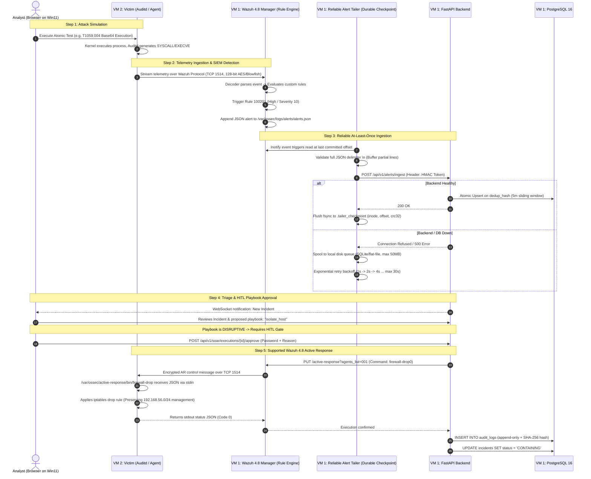

# SentinelOps — End-to-End Data Flow & Reliable Ingestion Architecture

## 1. Lifecycle Overview

The complete lifecycle flows across 6 discrete, resilient stages:
1. **Simulation** (Controlled execution on VM 2 via Atomic Red Team).
2. **Telemetry Ingestion & Detection** (Linux Auditd $\rightarrow$ Wazuh Agent $\rightarrow$ Wazuh Manager custom XML rules).
3. **Alert Ingestion & Forwarding** (Manager writes `/var/ossec/logs/alerts/alerts.json` $\rightarrow$ SentinelOps File Tailer $\rightarrow$ FastAPI Webhook).
4. **PostgreSQL Deduplication & Normalization** (Sliding-window duplicate suppression in DB).
5. **Enrichment & Incident Creation** (Asset context + MITRE technique info + Threat Intel fixtures $\rightarrow$ Incident state machine).
6. **SOAR Active Response & Audit** (Allowlisted playbook $\rightarrow$ HITL approval gate $\rightarrow$ Wazuh 4.8 AR stdin JSON $\rightarrow$ Append-only audit record).



---

## 2. Reliable At-Least-Once Alert Ingestion Design

To handle realistic operational failures without claiming unachievable "zero data loss", SentinelOps implements an **At-Least-Once Delivery Architecture with Durable Checkpointing**:

```
/var/ossec/logs/alerts/alerts.json
               │
               ▼
┌────────────────────────────────────────────────────────┐
│ SentinelOps Durable Tailer Daemon                      │
│                                                        │
│ 1. Line-Buffer Accumulator (Stitches partial JSON)    │
│ 2. Inode & Truncation Monitor (Handles logrotate)      │
│ 3. Checkpoint Store (Flushes offset + CRC32 to disk)   │
│ 4. Bounded Disk Spooler (Max 50 MB / SQLite buffer)    │
└──────────────────────────────────┬─────────────────────┘
                                   │
              HTTP POST (HMAC)     ▼
┌────────────────────────────────────────────────────────┐
│ SentinelOps FastAPI Backend (/api/v1/alerts/ingest)    │
│                                                        │
│ 5. Idempotent Upsert (PostgreSQL dedup_hash index)     │
│ 6. Duplicate Suppression & Event Count Increment       │
└────────────────────────────────────────────────────────┘
```

### 2.1 Durable Offset Checkpointing & State File
The tailer daemon tracks its exact reading progress in a persistent disk state file (`.tailer_checkpoint`):
```json
{
  "file_path": "/var/ossec/logs/alerts/alerts.json",
  "inode": 1058291,
  "byte_offset": 4819204,
  "last_event_timestamp": "2026-11-07T18:30:00Z",
  "crc32_checksum": "a4f891b2"
}
```
- **Sync Timing**: The checkpoint file is written to a temporary file (`.tailer_checkpoint.tmp`) and atomically renamed after a batch is acknowledged (`200 OK`) by the backend, followed by an `fsync()` system call.
- **Process Crash Recovery**: Upon restart, the tailer reads the checkpoint, verifies the file inode and size, and resumes reading from `byte_offset`.

### 2.2 Partial JSON Record Handling (Line-Buffer Accumulator)
- Wazuh writes alerts as newline-delimited JSON (`ndjson`). If a file read occurs midway through a write, the tailer encounters an incomplete JSON string.
- **Rule**: The tailer buffers characters until a trailing newline character (`\n`) is encountered and validates the string with `json.loads()`. If malformed, it pauses 50ms and retries reading to allow the OS flush to complete.

### 2.3 Log Rotation & Truncation Detection
- When Wazuh or `logrotate` rotates `alerts.json` (moving it to `alerts.json.1` or truncating):
  1. The tailer checks `os.fstat(fd).st_ino` on every batch.
  2. If the inode changes or if the current file size is less than `byte_offset` (file truncation):
     - The tailer finishes reading remaining bytes from the old file handle.
     - Resets `byte_offset = 0` for the newly created file handle.
     - Updates the checkpoint with the new inode.

### 2.4 Backend Downtime & Bounded Disk Spooling
- If the FastAPI backend or PostgreSQL database is offline:
  - The tailer halts checkpoint progression.
  - Diverts new incoming alerts to a local bounded SQLite spool queue (`/var/run/sentinelops/tailer_spool.db`).
  - **Bounded Buffer Limit**: Spool is capped at **50 MB** (approximately 50,000 alerts). If the cap is reached, oldest non-critical alerts are dropped to prevent disk exhaustion, and a critical system event is logged.
  - **Exponential Back-Pressure**: Retries HTTP POST with exponential backoff: $1\text{s} \rightarrow 2\text{s} \rightarrow 4\text{s} \rightarrow 8\text{s} \rightarrow 16\text{s} \rightarrow \text{max } 30\text{s}$.
  - When connection is restored, the tailer drains the disk spool in FIFO order before resuming live stream processing.

### 2.5 PostgreSQL Idempotency & Duplicate Handling
Because the tailer guarantees **at-least-once** delivery, process restarts during transit may deliver an alert twice.
- To achieve effective **exactly-once processing semantics**:
  - The backend computes a deterministic hash: $\text{dedup\_hash} = \text{SHA256}(\text{rule.id} + \text{agent.id} + \text{data.audit.command} + \text{timestamp\_window})$.
  - An atomic `ON CONFLICT (dedup_hash) DO UPDATE` query increments `occurrence_count` and updates `last_seen_at` without duplicating incidents or corrupting data.
