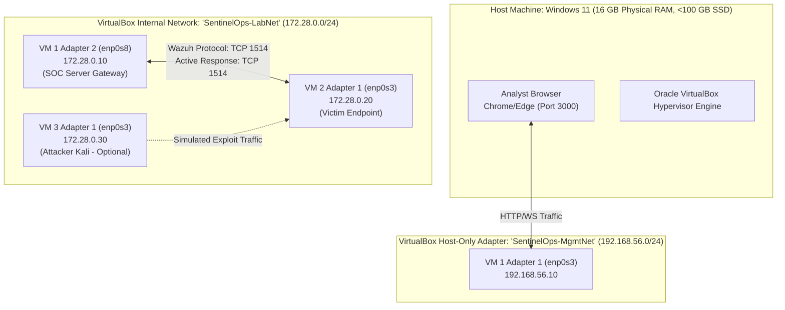

# SentinelOps — Infrastructure & Network Architecture

## 1. Physical Host & Virtualization Architecture

The entire lab runs on a Windows 11 host with 16 GB physical RAM and <100 GB available SSD space, virtualized using Oracle VirtualBox 7.x.



---

## 2. Realistic Staged Resource Planning (Windows 11 / 16 GB Physical RAM)

The Windows 11 host OS requires a **guaranteed 8.0 GB to 10.0 GB RAM headroom** to support OS services, VSCode/IDE, browser tabs, Git, background antivirus, and the VirtualBox hypervisor process overhead.

> [!WARNING]
> Running all components inside a **6.0 GB RAM VM is a constrained, experimental lab configuration**, not an enterprise-supported topology. It requires explicit JVM heap tuning and component scheduling.

To maintain physical system stability, SentinelOps establishes a **Strict Staged Deployment Strategy**:

```
Stage 1: SIEM & Platform Baseline (VM 1 Only)
┌─────────────────────────────────┬─────────────────────────────────┐
│ Windows 11 Host: 10.0 GB RAM    │ VM 1 (SOC Server): 6.0 GB RAM   │
│ (Development, Browser, IDE)     │ (Tuned Wazuh 4.14.10 + PG16)    │
└─────────────────────────────────┴─────────────────────────────────┘

Stage 2: Live Detection & ART Emulation (VM 1 + VM 2)
┌─────────────────────────────────┬───────────────────┬─────────────┐
│ Windows 11 Host: 8.0 GB RAM     │ VM 1: 6.0 GB RAM  │ VM 2: 2.0 GB│
│ (Browser, IDE, Git)             │ (Experimental)    │ (Victim)    │
└─────────────────────────────────┴───────────────────┴─────────────┘

Stage 3: External Multi-Node Emulation (Sequential Mode)
┌─────────────────────────────────┬───────────────────┬─────────────┐
│ Windows 11 Host: 12.0 GB RAM    │ VM 2: 2.0 GB RAM  │ VM 3: 2.0 GB│
│ (VM 1 is SHUT DOWN or PAUSED)   │ (Victim Target)   │ (Kali Linux)│
└─────────────────────────────────┴───────────────────┴─────────────┘
*Rule: VM 1 (SOC), VM 2 (Victim), and VM 3 (Kali) NEVER run simultaneously.*
```

### 2.1 Staged Operating Profiles

| Profile Name | Active Virtual Machines | RAM Allocation Breakdown | Host RAM Headroom | Operational Rules & Constraints |
| :--- | :--- | :--- | :--- | :--- |
| **Profile 1: SIEM & Ingestion Baseline** | **VM 1 Only** (SOC Server) | • Windows 11: **10.0 GB**<br>• VM 1: **6.0 GB** | **10.0 GB Free** | Rule development, backend coding, dashboard testing. VM 2 and Kali remain powered off. |
| **Profile 2: Live Detection & ART Emulation** | **VM 1 + VM 2** (SOC + Victim) | • Windows 11: **8.0 GB**<br>• VM 1: **6.0 GB**<br>• VM 2: **2.0 GB** | **8.0 GB Free** | Atomic Red Team runs locally on VM 2. SIEM detects and SOAR initiates containment. Total committed RAM: 8.0 GB (VMs). Preserves 8.0 GB for Windows. Kali is powered off. |
| **Profile 3: External Multi-Node Emulation** | **VM 2 + VM 3 (Sequential)** | • Windows 11: **12.0 GB**<br>• VM 2: **2.0 GB**<br>• VM 3: **2.0 GB** | **12.0 GB Free** | If Kali is used to generate network traffic, VM 1 is paused or shut down. Telemetry/PCAP is captured locally on VM 2, then replayed or analyzed sequentially. |

---

## 3. Storage Sizing, Retention & Validation Thresholds (<100 GB SSD Boundary)

All disk, EPS, and log volume estimates are **pre-operational estimates subject to empirical validation** in Phase 02/03.

### 3.1 Storage Allocations & Ceilings
- **Host Free Disk Boundary**: Maintain a minimum of **20 GB unallocated host SSD space** at all times.
- **Dynamic Virtual Disks (VDI)**:
  - VM 1 (SOC Server): Max ceiling 45 GB dynamic (initial disk image: ~12–14 GB).
  - VM 2 (Victim Endpoint): Max ceiling 15 GB dynamic (initial disk image: ~5–6 GB).
  - VM 3 (Kali Linux): Existing VM image (~18 GB).
- **Initial Total Disk Consumed**: ~35–38 GB (leaving >50 GB free on the host).

### 3.2 Estimated Telemetry Volume & Retention Policy (To Be Validated)
- **Estimated EPS**: Baseline idle ~1–3 EPS; active Atomic Red Team test bursts ~15–30 EPS.
- **Estimated Ingest Volume**: ~150–250 MB raw JSON logs per active lab day.
- **OpenSearch Index Retention**: 14-day rolling retention ceiling (estimated $\le 3.5\text{ GB}$).
- **Logrotate Policy**: Wazuh Manager `/var/ossec/logs/alerts/` and PostgreSQL WAL rotated daily with a 3-day max retention.

### 3.3 Storage Space Thresholds & Verification Procedure
- **Warning Threshold**: If free host SSD space drops below **15 GB**, development must pause and unneeded build artifacts/logs must be cleared.
- **Critical Threshold**: If free host SSD space drops below **10 GB**, OpenSearch indices older than 3 days are purged immediately.
- **Validation Procedure**: In Phase 02, verify actual dynamic disk size using:
  ```powershell
  Get-Item "$HOME\VirtualBox VMs\*\*.vdi" | Select-Object Name, @{Name="SizeGB";Expression={[math]::round($_.Length/1GB, 2)}}
  ```

---

## 4. VirtualBox Network Topology & IP Addressing Plan

SentinelOps uses two isolated network interfaces to guarantee zero external exposure:

### 4.1 Subnet Architecture

| Network Name | VirtualBox Type | Subnet CIDR | Purpose & Access Control |
| :--- | :--- | :--- | :--- |
| **`SentinelOps-MgmtNet`** | Host-Only Adapter (`VirtualBox Host-Only Ethernet Adapter`) | `192.168.56.0/24` | Management interface. Connects Windows 11 host browser to VM 1 (SOC Server). Isolated from victim and attacker VMs. |
| **`SentinelOps-LabNet`** | Internal Network (`intnet`) | `172.28.0.0/24` | Lab communication plane. Fully isolated virtual switch inside VirtualBox. Zero external routing or host visibility. |

### 4.2 IP Address Assignment Table

| Host / VM | Interface | Network | IP Address | MAC Address / Config |
| :--- | :--- | :--- | :--- | :--- |
| **Windows 11 Host** | VirtualBox Virtual Adapter | `SentinelOps-MgmtNet` | `192.168.56.1` | Static (Host Gateway) |
| **VM 1: SOC Server** | `enp0s3` (Adapter 1) | `SentinelOps-MgmtNet` | `192.168.56.10` | Static / Host-Only |
| **VM 1: SOC Server** | `enp0s8` (Adapter 2) | `SentinelOps-LabNet` | `172.28.0.10` | Static / Internal Net |
| **VM 2: Victim Endpoint** | `enp0s3` (Adapter 1) | `SentinelOps-LabNet` | `172.28.0.20` | Static / Internal Net |
| **VM 3: Attacker (Kali)** | `enp0s3` (Adapter 1) | `SentinelOps-LabNet` | `172.28.0.30` | Static / Internal Net |

---

## 5. Firewall & Port Filtering Rules (UFW / IPTables on VM 1)

VM 1 acts as the SOC barrier and enforces strict ingress/egress filtering:

```bash
# Default policies: DROP all forwarded and incoming traffic
sudo ufw default deny incoming
sudo ufw default deny forward
sudo ufw default allow outgoing

# Interface 1 (Host-Only: 192.168.56.0/24) - Management Only
sudo ufw allow in on enp0s3 to 192.168.56.10 port 22 proto tcp comment "SSH Management"
sudo ufw allow in on enp0s3 to 192.168.56.10 port 3000 proto tcp comment "SentinelOps Frontend"
sudo ufw allow in on enp0s3 to 192.168.56.10 port 8000 proto tcp comment "SentinelOps Backend API"
sudo ufw allow in on enp0s3 to 192.168.56.10 port 443 proto tcp comment "Wazuh Dashboard"

# Interface 2 (Lab-Net: 172.28.0.0/24) - Agent Telemetry Only
sudo ufw allow in on enp0s8 from 172.28.0.20 to 172.28.0.10 port 1514 proto tcp comment "Wazuh Agent Data"
sudo ufw allow in on enp0s8 from 172.28.0.20 to 172.28.0.10 port 1514 proto udp comment "Wazuh Agent UDP"
sudo ufw allow in on enp0s8 from 172.28.0.20 to 172.28.0.10 port 1515 proto tcp comment "Wazuh Agent Registration"

# Explicitly DROP everything else from Lab-Net (including any traffic from Attacker VM 3)
sudo ufw deny in on enp0s8 from 172.28.0.30 to any comment "Block Attacker from SOC Server"
```

### Internet Access Policy
- During initial provisioning (Phase 01–03), a temporary VirtualBox NAT adapter (`Adapter 3`) is enabled on VMs solely for `apt-get` and downloading Atomic Red Team definitions.
- Once provisioned, the NAT adapter is **disconnected** in VirtualBox settings. The lab operates completely offline with zero risk of accidental internet traffic.
