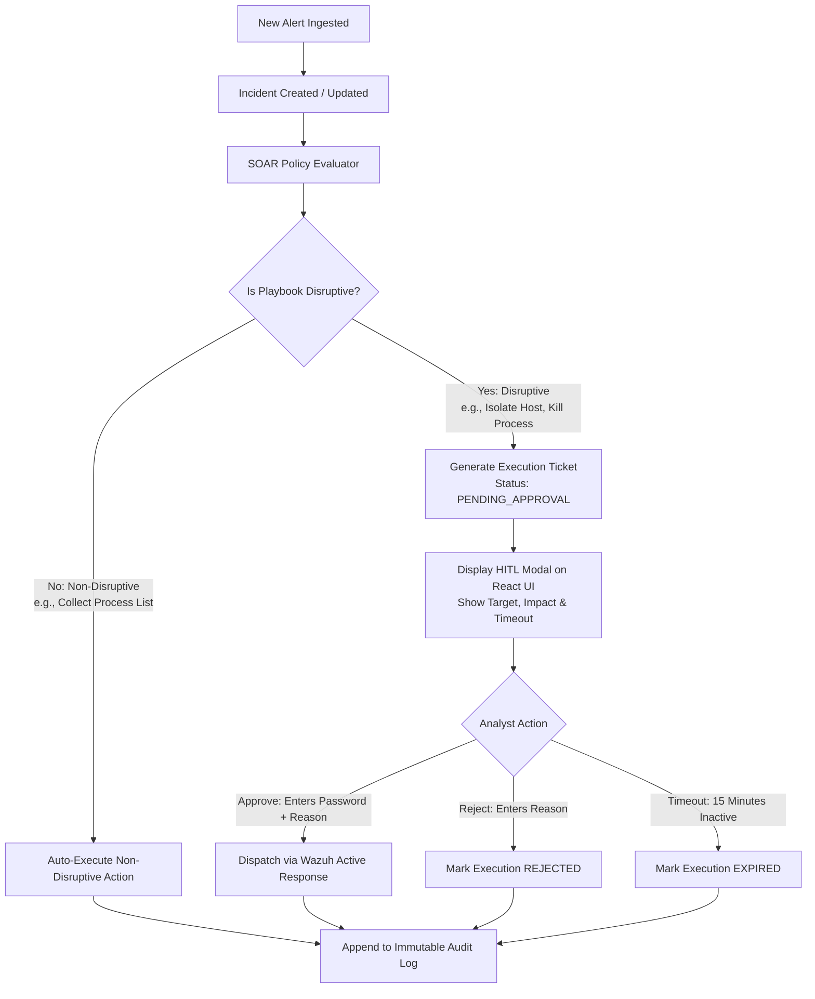

# SentinelOps — Security & Safety Architecture

## 1. Zero-Trust Lab Security Principles

SentinelOps operates on a defense-in-depth security model specifically tailored for isolated virtualized labs:
1. **Host-Lab Isolation**: The Windows 11 host is shielded from the internal attack simulation subnet (`172.28.0.0/24`).
2. **Defensive Response Boundaries**: SOAR automation must never execute arbitrary command strings or evaluate raw alert inputs.
3. **Mandatory Human Approval for Disruptive Actions**: No system can isolate a host, terminate processes, or delete files without an affirmative, authenticated human signature.
4. **Tested Containment Rollback**: Containment operations preserve an out-of-band management channel to allow reliable, non-destructive reversal.
5. **Non-Repudiation**: Append-only PostgreSQL permissions combined with SHA-256 cryptographic chaining.

---

## 2. Threat Modeling & Hardening (STRIDE)

| Threat | Lab Attack Vector | Architectural Countermeasure |
| :--- | :--- | :--- |
| **Spoofing** | Attacker injects forged alerts to trigger false response actions. | Ingestion webhook protected by pre-shared HMAC secret; Agent IDs validated against database inventory. |
| **Tampering** | Malware attempts to modify audit logs or clear incident history. | DB-level privilege revocation (`REVOKE UPDATE, DELETE ON audit_logs FROM sentinelops_app`) + cryptographic hash chaining. |
| **Repudiation** | Operator denies approving disruptive host isolation. | JWT analyst identity, timestamp, IP, and approval justification immutably recorded in audit logs. |
| **Information Disclosure** | Telemetry or lab credentials leak to public networks. | Hypervisor isolation (`SentinelOps-LabNet` is internal only, zero internet egress). |
| **Denial of Service** | High-volume attack simulations exhaust host RAM or disk. | PostgreSQL 5-minute sliding-window deduplication, OpenSearch 14-day index cleanup, logrotate 3-day retention. |
| **Elevation of Privilege** | Attacker exploits active response scripts via command injection. | **Zero-Shell Execution Architecture**: All parameters validated via Pydantic regex; native Wazuh Active Response scripts called with structured JSON. |

---

## 3. Command Injection Defense: Zero-Shell Active Response

### Vulnerability Vector in Naive SOC Systems
When an alert triggers an automated response, a common flaw is passing unescaped alert data (such as process names, file paths, or arguments) directly into shell commands:
```bash
# FORBIDDEN PATTERN IN SENTINELOPS
os.system(f"/var/ossec/bin/active-response/bin/custom-block.sh {alert.ip}")
```
If an adversary crafts an IP or process name containing shell metacharacters (e.g., `10.0.0.1; rm -rf /`), remote code execution occurs on the endpoint.

### SentinelOps Hardening Standard
1. **Allowlisted Static Scripts Only**: Active response scripts on VM 2 are pre-installed in `/var/ossec/active-response/bin/` with root ownership (`chmod 750`).
2. **Strict Pydantic Parameter Schemas**:
   ```python
   class HostIsolationParams(BaseModel):
       agent_id: constr(pattern=r"^[0-9]{3,5}$")
       action: Literal["isolate", "unisolate"]
   
   class KillProcessParams(BaseModel):
       agent_id: constr(pattern=r"^[0-9]{3,5}$")
       process_id: conint(ge=1, le=4194304)
   ```
3. **Supported Wazuh 4.8 Protocol**: Parameters are transmitted via the native Wazuh AR daemon directly to registered binaries over standard input (`stdin`) as a structured JSON object.

---

## 4. Human-in-the-Loop (HITL) Governance



### Action Classification Matrix

| Playbook Identifier | Action Name | Category | Disruptive? | Approval Required? | Rollback Supported? |
| :--- | :--- | :--- | :--- | :--- | :--- |
| `pb-collect-procs` | Collect Process Dump | Forensics | **No** | No (Auto) | N/A |
| `pb-netstat` | Query Active Sockets | Forensics | **No** | No (Auto) | N/A |
| `pb-isolate-host` | Isolate Endpoint Network | Containment | **Yes** | **Yes (HITL)** | **Yes** (`pb-unisolate-host`) |
| `pb-kill-proc` | Terminate Process ID | Containment | **Yes** | **Yes (HITL)** | No |
| `pb-quarantine-file`| Quarantine File to Vault | Containment | **Yes** | **Yes (HITL)** | **Yes** (Restore from vault) |

---

## 5. Controlled Containment Rollback vs. Last-Resort Emergency Shutdown

SentinelOps strictly bifurcates **safe operational rollback** from **destructive emergency shutdown**:

### 5.1 Safe Containment & Tested Rollback Procedure
1. **Preserved Out-of-Band Management Path**:
   - The containment firewall script (`firewall-drop`) is explicitly programmed to **never block** management subnet traffic:
     - Allow: `192.168.56.0/24` (Host management) and `172.28.0.10:1514` (Wazuh telemetry/AR channel).
     - Block: All other inbound/outbound packets to the victim node.
   - This ensures the Wazuh Agent connection remains active, allowing immediate automated rollback.
2. **Standard Rollback Workflow**:
   - The analyst clicks **"Rollback Containment"** on the Incident workbench.
   - SentinelOps backend calls Wazuh API to issue the `"command": "delete"` action to the agent.
   - The agent script flushes the containment rule and restores network routing without rebooting or corrupting disk state.

### 5.2 Last-Resort Emergency Shutdown (Potentially Destructive)
If an adversary escapes lab containment or executes an uncontrollable denial-of-service:
- **Procedure**: An out-of-band host script (`scripts/emergency_poweroff.ps1`) executes:
  ```powershell
  VBoxManage controlvm "SentinelOps-Victim" poweroff
  ```
- **Risk Label**: Clearly labeled as **Potentially Destructive (Simulates pulling physical power plug)**. May cause filesystem corruption or loss of uncommitted in-memory forensic evidence. Reserved strictly for catastrophic lab safety boundaries.

---

## 6. Append-Only Audit Logging & Tamper Detection

1. **Database-Level Controls**:
   - The application PostgreSQL user `sentinelops_app` has `GRANT SELECT, INSERT ON audit_logs`.
   - `UPDATE` and `DELETE` are revoked at the database engine level.
2. **Cryptographic Chaining (Tamper Detection)**:
   - Each audit record includes a hash of the previous record:
     $$\text{entry\_hash}_i = \text{SHA256}(\text{timestamp}_i + \text{user\_id}_i + \text{action}_i + \text{details}_i + \text{entry\_hash}_{i-1})$$
   - A routine verification script runs during integrity checks to ensure the chain has not been severed or modified.
