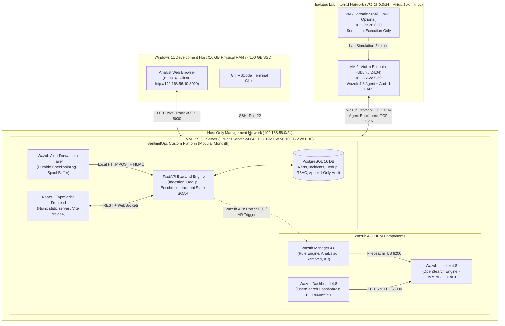
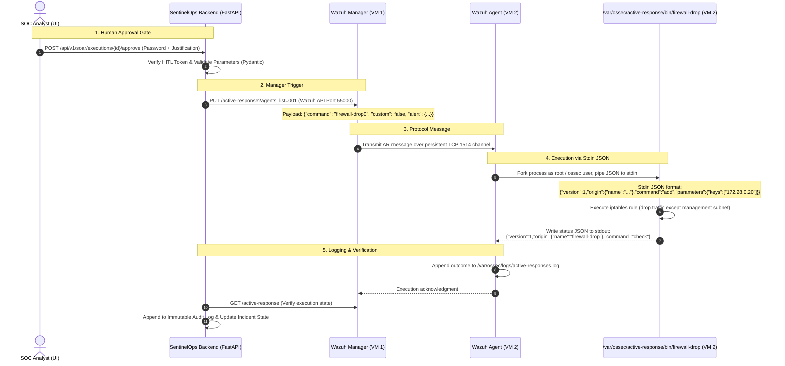

# SentinelOps — System Architecture Document

## 1. Architectural Philosophy & Physical Deployment Topology

SentinelOps adheres to a **Modular Monolith** pattern deployed across a multi-tier virtualized infrastructure on a Windows 11 development workstation.

### Physical vs. Virtual Topology
- **Host Machine**: Windows 11 (Development, Git, IDE, Browser Client).
- **Virtualization**: Oracle VirtualBox.
- **VM 1: SOC Server (Ubuntu Server 24.04 LTS)**: Centralized SIEM, custom SentinelOps backend, and relational datastore.
- **VM 2: Victim Endpoint (Ubuntu 24.04 LTS)**: Target asset with Wazuh Agent and Atomic Red Team harness.
- **VM 3: Attacker (Kali Linux - Optional)**: Secondary offensive testing node used sequentially.



---

## 2. Pinned Wazuh Architecture & Protocol Details (Wazuh 4.8)

SentinelOps pins **Wazuh 4.8 LTS** across all SIEM components to guarantee predictable protocol behavior and prevent feature mismatch.

### 2.1 Communication Links & Security Standards

| Communication Link | Transport Protocol | Cryptography / Authentication Standard | Official Wazuh 4.8 Mechanism |
| :--- | :--- | :--- | :--- |
| **Agent $\rightarrow$ Manager (Telemetry)** | TCP/UDP 1514 | Symmetric Encryption (AES-128 / Blowfish). Key size: 128-bit key negotiated from the pre-shared agent key string stored in `/var/ossec/etc/client.keys`. | `wazuh-remoted` daemon handles encrypted payload framing. (Official doc: Wazuh Agent-Manager communication). |
| **Agent Enrollment** | TCP 1515 | TLS 1.2+ encrypted tunnel | `wazuh-authd` daemon verifies password/token and issues unique agent ID & 128-bit key. |
| **Active Response (AR)** | TCP 1514 (Internal channel) | Encrypted message within the persistent agent session | Manager sends an internal AR control message: `(msg_to_agent) [] AR_command JSON_payload`. |
| **Manager $\rightarrow$ Indexer** | HTTPS / Port 9200 | TLS 1.3 / Mutual TLS (mTLS) with internal x509 certs | OpenSearch REST API indexing via `Filebeat-oss` / native output. |
| **Dashboard $\rightarrow$ Indexer/Manager**| HTTPS / Port 443, 55000 | TLS 1.3 with Basic Auth & JWT tokens | Node.js Dashboard app queries OpenSearch (9200) and Wazuh Manager API (55000). |

---

## 3. Supported Wazuh 4.8 Active Response Architecture

Active Response in Wazuh 4.8 operates via predefined agent-side binaries communicating through JSON over standard input (stdin) and standard output (stdout):



### 3.1 Wazuh 4.8 JSON Input Schema (Stdin)
When an Active Response command executes on the agent, Wazuh 4.8 pipes a structured JSON document to the script's standard input (`stdin`):
```json
{
  "version": 1,
  "origin": {
    "name": "node01",
    "module": "wazuh-execd"
  },
  "command": "add",
  "parameters": {
    "keys": ["172.28.0.20"],
    "alert": {
      "rule": { "id": "100201", "level": 12 },
      "agent": { "id": "001", "name": "ubuntu-victim" },
      "data": { "srcip": "172.28.0.20" }
    }
  }
}
```

### 3.2 Key Operational Constraints
- **Execution Privileges**: The executable is invoked by `wazuh-execd` (running as root on Linux).
- **Execution Timeout**: Default execution timeout is 10 seconds. If the script does not return a zero status code within 10 seconds, `wazuh-execd` terminates the child process and logs an error in `/var/ossec/logs/active-responses.log`.
- **Reversal / Rollback**: Supported commands (e.g., `firewall-drop`) implement a `delete` command mode (`"command": "delete"`). When rollback is triggered via the SentinelOps UI, the same script is executed with `"command": "delete"` to remove the iptables rule cleanly.

---

## 4. Controlled Containment Rollback vs. Last-Resort Emergency Shutdown

SentinelOps strictly bifurcates **safe operational rollback** from **destructive emergency shutdown**:

### 4.1 Safe Containment & Tested Rollback Procedure
1. **Preserved Out-of-Band Management Path**:
   - The containment firewall script (`firewall-drop`) is explicitly programmed to **never block** management subnet traffic:
     - Allow: `192.168.56.0/24` (Host management) and `172.28.0.10:1514` (Wazuh telemetry/AR channel).
     - Block: All other inbound/outbound packets to the victim node.
   - This ensures the Wazuh Agent connection remains active, allowing immediate automated rollback.
2. **Standard Rollback Workflow**:
   - The analyst clicks **"Rollback Containment"** on the Incident workbench.
   - SentinelOps backend calls Wazuh API to issue the `"command": "delete"` action to the agent.
   - The agent script flushes the containment rule and restores network routing without rebooting or corrupting disk state.

### 4.2 Last-Resort Emergency Shutdown (Potentially Destructive)
If an adversary escapes lab containment or executes an uncontrollable denial-of-service:
- **Procedure**: An out-of-band host script (`scripts/emergency_poweroff.ps1`) executes:
  ```powershell
  VBoxManage controlvm "SentinelOps-Victim" poweroff
  ```
- **Risk Label**: Clearly labeled as **Potentially Destructive (Simulates pulling physical power plug)**. May cause filesystem corruption or loss of uncommitted in-memory forensic evidence. Reserved strictly for catastrophic lab safety boundaries.
